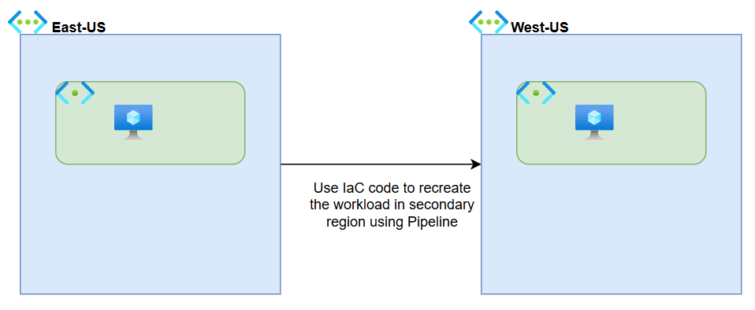
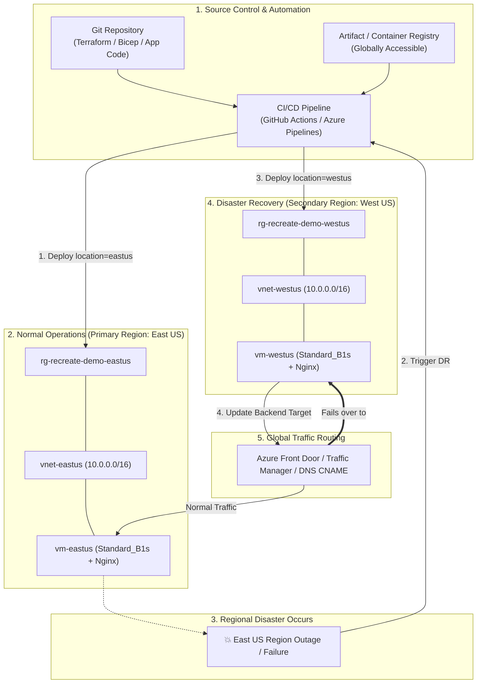

# DR Strategy 1: Recreate Workloads in Secondary Region (Cold DR)



---

## 1. Executive Summary & The HA / DR Spectrum

In Microsoft Azure and modern cloud architecture, Disaster Recovery (DR) strategies are categorized into three core patterns based on **Cost vs. Recovery Speed**:

| Strategy | Standby Cost | RTO (Recovery Time) | RPO (Data Loss) | Primary Azure Services | Best Suited For |
| :--- | :--- | :--- | :--- | :--- | :--- |
| **1. Recreate (Cold DR)** *(Current)* | **$0 / month** | **15 – 45 mins** | **0** (Stateless compute) | Terraform, Bicep, Azure Pipelines, GitHub Actions | Stateless APIs, Dev/QA, batch workers, internal tools |
| **2. Backup & Restore** | Low ($$) | Hours | Hours (Backup interval) | Recovery Services Vault (RSV), Azure Backup, Azure SQL Geo-Restore | Databases, line-of-business apps with state |
| **3. Replicate (Warm / Hot DR)** | High ($$$) | Seconds to Minutes | Near-zero | Azure Site Recovery (ASR), SQL Active Geo-Replication / Failover Groups | Mission-critical apps, customer payment gateways |

---

## 2. Core Philosophy of the "Recreate" Pattern

In on-premises data centers, disaster recovery required buying double the physical hardware and letting it sit powered on, consuming electricity and maintenance costs.

In Azure, infrastructure is **code (IaC)**. The core philosophy of the **Recreate** pattern is:

> *"Do not pay for idle servers in a second region. Store the complete infrastructure blueprint in Git, and provision it in the secondary region only if the primary region fails."*

### Key Characteristics:
* **Zero Idle Compute Cost**: Secondary region (`West US`) has zero running VMs or compute resources during normal operations.
* **Single Source of Truth**: 100% of the networking, security rules, compute, and configuration are defined in **Infrastructure as Code (Terraform or Bicep)**.
* **Disposable Infrastructure**: Servers are treated as "cattle, not pets". If the primary region has a disaster, you do not fix it—you stamp out a fresh copy in another region.

---

## 3. High-Level Architecture & End-to-End Flow



### The 4 Pillars of the Design:
1. **Parameterized Templates**:
   * The region is passed as an input variable (`target_region = "eastus"` vs `"westus"`). Hardcoding region names is strictly forbidden.
2. **Stateless Compute**:
   * Compute instances hold no local persistent data. Storage assets (database records, images, PDFs) reside on decoupled cloud services (e.g., Azure Blob Storage with Geo-redundancy or Azure SQL).
3. **Automated Provisioning Pipeline**:
   * A pipeline run can stamp out the entire environment in the secondary region unattended.
4. **Traffic Steering**:
   * A global traffic layer (**Azure Front Door** or **Azure Traffic Manager**) or a DNS CNAME entry routes client traffic to whichever region is currently active.

---

## 4. Real-World Business Scenarios

### Scenario A: Monthly Invoice PDF Generator Service
* **Behavior**: Takes order information, compiles invoices into PDF format, and uploads them to Azure Blob Storage.
* **Why Recreate is Chosen**:
  * The service holds no database on its local disk.
  * If `East US` goes down at 2:00 PM, generating non-urgent PDF invoices can pause for 30 minutes without affecting order transactions.
  * The company saves thousands of dollars annually by avoiding 24/7 idle redundant VMs.

### Scenario B: Non-Production (Dev / QA / Staging) Environments
* **Behavior**: Engineering team's sandbox and test clusters.
* **Why Recreate is Chosen**:
  * During a regional disaster, business continuity focuses on Production.
  * Development stacks are rebuilt in an alternate region via pipeline only when needed.

### Scenario C: Nightly Batch ETL / Data Crunching Workers
* **Behavior**: Scheduled worker VMs that execute nightly analytical calculations between 1:00 AM and 4:00 AM.
* **Why Recreate is Chosen**:
  * Workers run only when scheduled. If the primary region experiences failure, the scheduler points the IaC deployment to the secondary region before starting the batch job.

---

## 5. Recovery Objectives (RTO & RPO) Deep Dive

### ⏱️ Recovery Time Objective (RTO)
* **Definition**: The total elapsed time from when disaster is declared until the workload is serving traffic in the secondary region.
* **For Recreate**: **15 – 45 minutes**.
* **What constitutes this time?**
  1. **Detection & Decision**: 5 – 10 minutes (identifying that the regional outage is prolonged and declaring DR).
  2. **Pipeline Execution**: 5 – 15 minutes (Azure spinning up VNet, NSG, NIC, Public IP, and VM disk).
  3. **VM Initialization & Boot**: 2 – 5 minutes (cloud-init script installing packages, starting Nginx/App).
  4. **DNS / Routing Propagation**: 1 – 5 minutes (updating Azure Front Door / DNS TTL).

### 💾 Recovery Point Objective (RPO)
* **Definition**: The maximum acceptable amount of data loss measured in time.
* **For Recreate**: **Zero seconds for code and configuration**.
  * All configurations are committed to Git.
  * Any application data must be stored in external storage designed for DR (such as GRS Blob Storage or replicated databases).

---

## 6. Real-World Gotchas & Architectural Pitfalls

While "Recreate" is the most cost-efficient pattern, architects must plan for three major risks:

1. **Azure Regional Capacity Exhaustion**:
   * In a major regional outage affecting hundreds of enterprises, many organizations will simultaneously attempt to spin up VMs in the paired region (e.g., `West US`).
   * **Mitigation**: Use widely available, standard VM families, or design the IaC to fall back to alternative SKUs if your primary SKU runs out of quota.
2. **Subscription Quotas**:
   * Azure limits vCPU counts per region. Ensure your subscription has pre-approved vCPU quotas in the secondary region *before* an incident occurs.
3. **Dynamic IP Changes**:
   * A recreated VM in `West US` receives a brand new Public IP address.
   * **Mitigation**: Never give clients raw IP addresses. Always front the application with a DNS hostname, **Azure Front Door**, or **Azure Traffic Manager**.

---

## 7. Hands-On Lab: How to Test the Pattern

The Terraform files in this directory allow you to deploy, simulate failover, and measure RTO hands-on.

### File Structure:
* `main.tf`: Defines Resource Group, VNet, Subnet, Public IP, NSG, and a lightweight Linux VM (`Standard_B1s`) configured with Nginx and a region-identifying landing page.

### Step 1: Deploy to Primary Region (`East US`)
Run in PowerShell:
```powershell
cd c:\Users\rag\Desktop\AzureProject\HA_DR\1.Recreate
terraform init
terraform apply -var="target_region=eastus" -auto-approve
```
* Once complete, open the output `web_url` in your browser.
* You will see: **"Current Azure Region: eastus"**.

### Step 2: Simulate Disaster & Recreate in Secondary Region (`West US`)
Simulate that `eastus` has experienced an outage. Run the recreate deployment while measuring the RTO:
```powershell
Measure-Command {
    terraform apply -var="target_region=westus" -auto-approve
}
```
* Note the output `web_url` (in `westus`).
* Open the URL in your browser: You will see **"Current Azure Region: westus"**.
* The execution time returned by `Measure-Command` represents your **actual RTO**!

### Step 3: Cleanup Lab Resources
To avoid any unwanted cloud costs after testing:
```powershell
terraform destroy -var="target_region=westus" -auto-approve
```
*(If you also deployed into `eastus`, run `terraform destroy -var="target_region=eastus" -auto-approve` as well).*

---

## 8. What Comes Next?

* **Limitation of Recreate**: It works only when there is **no persistent state/database** tied to the VM.
* In the next section, **[2. Backup & Restore](../2.BackupRestore/README.md)**, we will address stateful workloads (like Azure SQL databases and Recovery Services Vault - RSV) where data must be preserved and restored.
