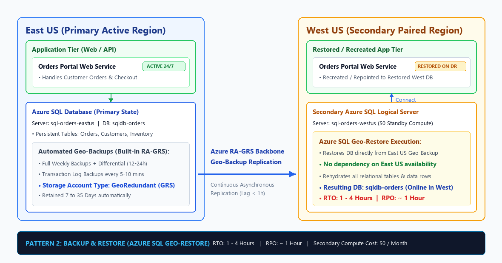
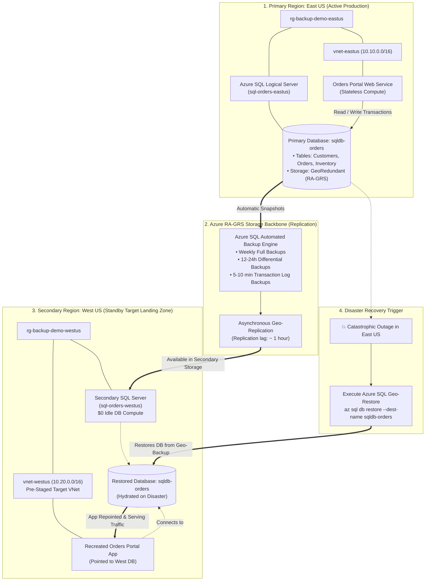

# DR Strategy 2: Backup & Restore for Stateful Applications (Azure SQL Geo-Restore)



---

## 1. Executive Summary & The HA / DR Spectrum

In Microsoft Azure and modern cloud architecture, Disaster Recovery (DR) strategies are categorized into three core patterns based on **Cost vs. Recovery Speed**:

| Strategy | Standby Compute Cost | RTO (Recovery Time) | RPO (Data Loss) | Primary Azure Services | Best Suited For |
| :--- | :--- | :--- | :--- | :--- | :--- |
| **1. Recreate (Cold DR)** | **$0 / month** | **15 – 45 mins** | **0** (Stateless compute) | Terraform, Bicep, Azure Pipelines, GitHub Actions | Stateless APIs, Dev/QA, batch workers, internal tools |
| **2. Backup & Restore** *(Current)* | **$0 / month** *(Storage only)* | **1 – 4 Hours** | **~ 1 Hour** | Azure SQL Database (Geo-Restore), Storage RA-GRS, Recovery Services Vault (CRR) | Relational databases, line-of-business apps, order management, ERP/CRM |
| **3. Replicate (Warm / Hot DR)** | High ($$$) *(24/7 Running Replica)* | Seconds to Minutes | Near-zero (< 5s) | Azure SQL Active Geo-Replication, Auto-Failover Groups, Azure Site Recovery | Mission-critical financial systems, 24/7 payment gateways, real-time trading |

---

## 2. Core Philosophy of the "Backup & Restore" Pattern for Stateful Workloads

In **Strategy 1 (Recreate)**, we learned that stateless application servers can be treated as disposable "cattle" and provisioned in minutes using Infrastructure as Code (Terraform). However, real-world systems are powered by **relational databases containing business state**—customer accounts, financial ledgers, inventory counts, and pending order transactions. 

If a regional disaster strikes `East US`, spinning up a fresh web server in `West US` is useless if the database is gone. 

The core philosophy of the **Backup & Restore** pattern for stateful applications is:

> *"Decouple state from compute. Asynchronously replicate automated database backups to Azure's paired region using Geo-Redundant Storage (RA-GRS). Pay $0 for idle database compute in the secondary region during normal operations, and restore the database on-demand if disaster strikes."*

### Key Characteristics:
* **Zero Standby Database Compute Cost**: The secondary region (`West US`) runs **no active database replica** during normal operations. You do not pay double compute bills.
* **Automated Azure SQL Backup Engine**: Azure SQL Database automatically executes:
  * **Full backups** weekly.
  * **Differential backups** every 12 to 24 hours.
  * **Transaction log backups** every 5 to 10 minutes.
* **Built-in Geo-Redundancy (RA-GRS)**: All backup files are automatically copied asynchronously across Microsoft's high-speed private backbone to the paired region (`West US`).
* **Geo-Restore Capability**: Enables self-service restoration of the database into the secondary region even when the primary region is completely offline and unreachable.
* **Point-in-Time Recovery (PITR)**: Protects against both physical cloud datacenter failures and human error (such as accidental `DROP TABLE` commands or ransomware).

---

## 3. High-Level Architecture & End-to-End Flow



### The 4 Pillars of the Azure SQL Geo-Restore Design:

1. **Storage Redundancy Configuration (`storage_account_type = "Geo"`)**:
   * Azure SQL databases can be configured with `Local` (LRS), `Zone` (ZRS), or `Geo` (GRS / RA-GRS) backup storage.
   * Selecting **`Geo`** ensures backups are automatically replicated to the paired region 500+ miles away, unlocking the **Geo-Restore** capability.
2. **Zero Secondary Compute Overhead**:
   * Unlike **Strategy 3 (Active Geo-Replication)** where you pay for a second SQL Database running 24/7 in `West US`, **Geo-Restore** incurs **$0 in database compute costs** until you actually perform a restore.
3. **Independent Regional Availability**:
   * The restore operation reads backup blobs directly from the secondary storage endpoint in `West US`. Even if `East US` is completely blacked out, the restore succeeds without communicating with any primary region infrastructure.
4. **Flexible Sizing on Restore**:
   * During recovery or a test drill, you can restore the database into a different service tier (e.g., restore a production `General Purpose` or `Business Critical` database to a cheap `Standard S0` tier) to run non-disruptive validation tests without massive cost.

---

## 4. Real-World Business Scenario: "Contoso Orders Portal"

### The Business Context:
* **Application**: An internal and B2B ordering portal where enterprise clients submit purchase orders.
* **Database State**: Contains order numbers, customer billing profiles, line items, order statuses, and warehouse inventory reservations.
* **Cost vs. SLA Evaluation**:
  * An active hot standby replica in `West US` would cost \$1,500 – \$3,000/month in continuous SQL compute.
  * The business determined that if an unprecedented regional disaster knocks out an entire Azure region:
    * Waiting **1 to 2 hours** to restore the database is acceptable.
    * Losing up to **1 hour of recent transaction history (RPO ~ 1h)** can be reconciled via sales email confirmations and warehouse re-scans.
* **Decision**: Implement **Pattern 2: Backup & Restore using Azure SQL Geo-Restore**, saving the company over \$25,000 annually in idle cloud bills while remaining fully compliant with corporate disaster recovery guidelines.

---

## 5. Recovery Objectives (RTO & RPO) Deep Dive

### ⏱️ Recovery Time Objective (RTO)
* **Definition**: The total elapsed time from when disaster is declared until the application and database are operational and serving customer traffic in the secondary region.
* **For Azure SQL Geo-Restore**: **1 – 4 Hours**.
* **What constitutes this time?**
  1. **Disaster Declaration & Decision**: 15 – 30 minutes (verifying regional outage severity and authorizing failover).
  2. **Geo-Restore Execution**: 30 – 120 minutes (Azure allocates compute nodes in `West US`, formats database files, downloads the latest full/differential backups, and applies transaction logs from secondary storage). *Duration depends on database size and transaction volume.*
  3. **App Tier Deployment / Repointing**: 10 – 15 minutes (recreating the web application in `West US` and updating its connection string).
  4. **Data Sanity Validation**: 10 minutes (running SQL smoke tests to confirm table integrity and record counts).
  5. **DNS / Global Traffic Switch**: 5 – 10 minutes (updating Azure Front Door backend pool or DNS CNAME).

### 💾 Recovery Point Objective (RPO)
* **Definition**: The maximum acceptable data loss measured in elapsed time.
* **For Azure SQL Geo-Restore**: **~ 1 Hour**.
* **How is this determined?**
  * Azure SQL transaction logs are taken every 5 to 10 minutes.
  * The geo-replication mechanism asynchronously batches and replicates these log backups to the paired region storage account.
  * Microsoft commits to an RPO of approximately **1 hour** for geo-replicated backups. Any transactions committed in the primary database within the last ~60 minutes prior to a sudden failure may not have completed replication to the secondary region.

---

## 6. Real-World Gotchas & Architectural Pitfalls

1. **Verify Backup Storage Redundancy**:
   * If an Azure SQL database is mistakenly created with `storage_account_type = "Local"` (LRS) or `"Zone"` (ZRS) to save a few dollars, **Geo-Restore is completely impossible**. Backups exist only in the primary region. Always verify that `storage_account_type = "Geo"` in Terraform.
2. **Server-Level Logins & Firewall Rules**:
   * An Azure SQL Database restore restores the database data, but **does not copy server-level firewall rules or server logins**.
   * *Best Practice*: Pre-stage the secondary logical server (`sql-orders-westus`) with identical firewall rules, administrator logins, and contained database users (`CREATE USER ... WITH PASSWORD`).
3. **Database Collation & Master Keys**:
   * Ensure any database master keys (DMK) and certificates used for cell-level encryption (CLE) or external tables are backed up and documented so they can be restored in the target server.
4. **Connection String Architecture**:
   * Never hardcode the primary SQL server FQDN (`sql-orders-eastus.database.windows.net`) inside application code.
   * *Best Practice*: Use environment variables, Azure Key Vault references, or Azure SQL Server DNS Aliases (`az sql server dns-alias`) to switch endpoints seamlessly during failover.
5. **Testing Without Disrupting Production**:
   * One of the greatest benefits of Geo-Restore is testability. You can run `az sql db restore` into `West US` on any Tuesday afternoon to test DR without pausing or affecting the live production database in `East US`.

---

## 7. Hands-On Lab: How to Test the Pattern

The Terraform code in this directory deploys:
1. **Primary Region (`East US`)**: Resource Group, VNet, Web VM running the Orders Portal, and an **Azure SQL Database** (`sqldb-orders`) configured with **Geo-redundant automated backups (`storage_account_type = "Geo"`)**.
2. **Secondary Region (`West US`)**: Standby Resource Group, Target VNet, and a **Secondary Azure SQL Logical Server** configured with \$0 active database compute.

### File Structure:
* `main.tf`: Complete declarative Terraform code for the App and Azure SQL database tiers.
* `image.png`: Architecture diagram showing the replication and Geo-Restore flow.

---

### Step 1: Deploy Primary and Secondary Infrastructure
Open PowerShell in this directory:
```powershell
cd c:\Users\rag\Desktop\AzureProject\HA_DR\2.BackupRestore
terraform init
terraform apply -auto-approve
```

Key outputs returned:
* `primary_web_url`: Orders Portal URL running in `East US`.
* `primary_sql_server_fqdn`: `sql-backup-demo-eastus.database.windows.net`
* `primary_database_name`: `sqldb-orders`
* `secondary_sql_server_fqdn`: `sql-backup-demo-westus.database.windows.net`
* `geo_backup_status`: `Enabled (Storage Account Type: Geo)`

---

### Step 2: Verify the Live Connected Application
1. Open the URL provided in `primary_web_url` in your browser.
2. Observe the live two-tier architecture:
   * **Badge**: `LIVE AZURE SQL CONNECTION`
   * **Live Query Latency**: Displays round-trip SQL execution time in milliseconds (e.g. `12 ms`).
   * **Connected Database**: `sql-backup-demo-eastus-xxxx.database.windows.net` / `sqldb-orders`.
   * **Live Orders Table**: Shows seeded transaction rows queried directly from Azure SQL table on each request.

---

### Step 3: Insert a Real Transaction into Azure SQL
1. In the web application, locate the **"Insert Real Transaction into Azure SQL"** form.
2. Enter a test order:
   * **Customer Name**: `Northwind Global Ltd`
   * **Amount**: `75000.00`
   * **Status**: `Paid`
3. Click **"+ Insert Order"**.
4. The page refreshes and displays your new transaction committed into the Azure SQL Database with a fresh timestamp!

---

### Step 4: Check Available Geo-Backups in the Secondary Region
Using Azure CLI, query the recoverable geo-backups accessible from `West US`:

```powershell
# Retrieve resource names from Terraform outputs
$primaryServer = terraform output -raw primary_sql_server_name
$primaryDb = terraform output -raw primary_database_name
$secServer = terraform output -raw secondary_sql_server_name
$secRg = terraform output -raw secondary_resource_group

# Query geo-backups available in West US
az sql db geo-backup show `
    --resource-group (terraform output -raw primary_resource_group) `
    --server $primaryServer `
    --database $primaryDb
```

---

### Step 5: Simulate Disaster & Execute Azure SQL Geo-Restore
Simulate that `East US` has suffered a prolonged outage. Initiate **Geo-Restore** directly into the secondary SQL server in `West US`:

```powershell
# Execute Geo-Restore into the West US logical server
az sql db restore `
    --resource-group $secRg `
    --server $secServer `
    --name $primaryDb `
    --dest-name "sqldb-orders-restored" `
    --edition "Standard" `
    --service-objective "S0"
```

Azure allocates compute in `West US`, streams the geo-backup from secondary RA-GRS storage, and brings the database online with 100% of the relational data intact!

---

### Step 6: Verify Restored State in Secondary Region
Verify the restored database status in `West US`:
```powershell
az sql db show `
    --resource-group $secRg `
    --server $secServer `
    --name "sqldb-orders-restored" `
    --query "{Name:name, Status:status, EarliestRestoreDate:earliestRestoreDate}" `
    --output table
```

Recreate or repoint the application connection string to `sql-backup-demo-westus.database.windows.net`. All customer orders and financial records are preserved!

---

### Step 7: Cleanup Lab Resources
When testing is complete, destroy all cloud resources:

```powershell
terraform destroy -auto-approve
```

---

## 8. What Comes Next?

* **Limitation of Backup & Restore**: While Geo-Restore provides incredible cost efficiency ($0 standby database compute), an **RTO of 1 – 4 hours** and **RPO of ~1 hour** does not meet the requirements of mission-critical or financial payment systems.
* In the next section, **[3. Replicate (Warm / Hot DR via Azure SQL Active Geo-Replication & ASR)](../3.Replicate_ASR/README.md)**, we will examine continuous active replication to achieve an **RTO < 30 seconds** and **RPO < 5 seconds**.
