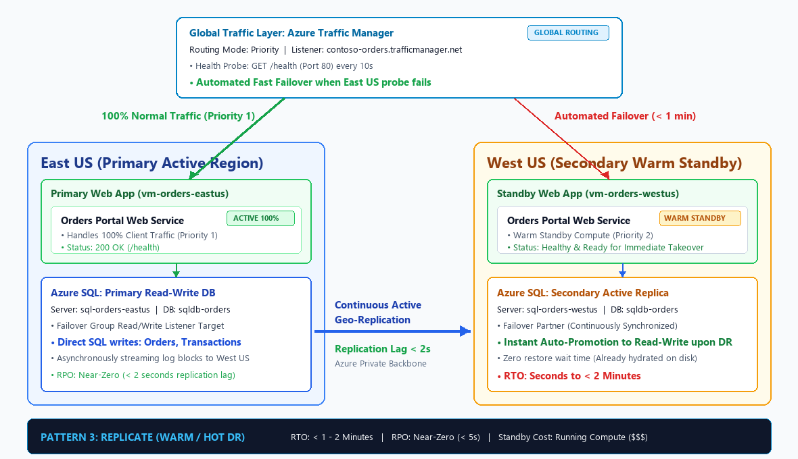
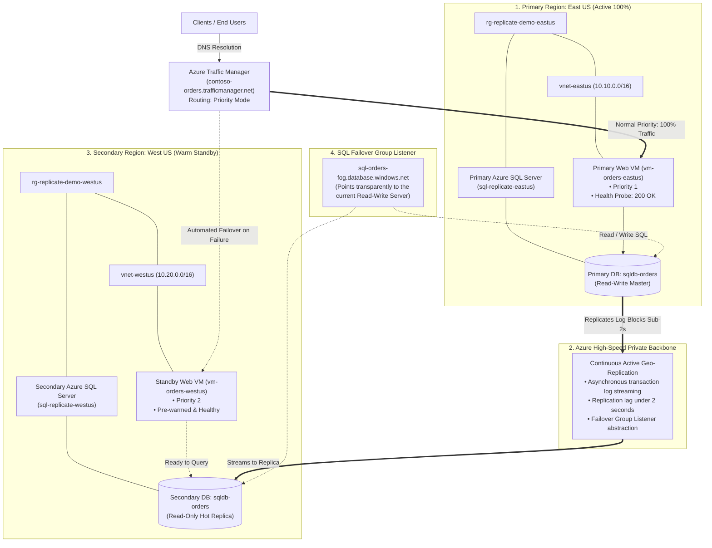

# DR Strategy 3: Active Replication & Warm/Hot Failover (ASR & SQL Geo-Replication)



---

## 1. Executive Summary & The HA / DR Spectrum

In Microsoft Azure and modern cloud architecture, Disaster Recovery (DR) strategies are categorized into three core patterns based on **Cost vs. Recovery Speed**:

| Strategy | Standby Compute Cost | RTO (Recovery Time) | RPO (Data Loss) | Primary Azure Services | Best Suited For |
| :--- | :--- | :--- | :--- | :--- | :--- |
| **1. Recreate (Cold DR)** | **$0 / month** | **15 – 45 mins** | **0** (Stateless compute) | Terraform, Bicep, Azure Pipelines, GitHub Actions | Stateless APIs, Dev/QA, batch workers, internal tools |
| **2. Backup & Restore** | **$0 / month** *(Storage only)* | **1 – 4 Hours** | **~ 1 Hour** | Azure SQL (Geo-Restore), Storage RA-GRS, Recovery Services Vault (CRR) | Line-of-business apps, non-critical databases, reporting systems |
| **3. Replicate (Warm / Hot DR)** *(Current)* | **High ($$$)** *(24/7 Running Compute)* | **< 1 – 2 Minutes** | **Near-zero (< 5s)** | Azure SQL Auto-Failover Groups, Active Geo-Replication, Azure Site Recovery (ASR), Azure Traffic Manager, Azure Front Door | Mission-critical financial systems, payment gateways, e-commerce checkout, 24/7 customer portals |

---

## 2. Core Philosophy of the "Replicate" Pattern

In **Strategy 1 (Recreate)** and **Strategy 2 (Backup & Restore)**, we saved infrastructure costs by keeping the secondary region idle ($0 standby compute). However, during an outage, the business is forced to accept **hours of downtime** while disks are hydrated and virtual machines are provisioned.

For revenue-critical operations—where every minute of downtime costs thousands of dollars in lost transactions and brand reputation—waiting hours for a restore is unacceptable.

The core philosophy of the **Replicate** pattern is:

> *"Eliminate recovery wait times completely. Pre-warm redundant compute in the secondary region, continuously stream data changes in near-real-time across the cloud backbone, and let global traffic directors steer users automatically when health checks fail."*

### Key Characteristics:
* **Pre-Warmed Secondary Compute**: Secondary virtual machines run 24/7 in `West US`, receiving code deployments simultaneously with the primary region.
* **Continuous Asynchronous Replication**: Database transaction log records and disk blocks stream across Microsoft's high-speed private backbone with a replication lag of **under 2 seconds**.
* **Global Health Probing & Automated Failover**: Global routing monitors application endpoints (`/health`). If the primary region stops responding, traffic is diverted to the secondary region automatically without human intervention.
* **Zero Disk Hydration Wait**: The secondary database is already mounted, formatted, and hydrated with data. Failover is a logical promotion (Read-Only $\rightarrow$ Read-Write), taking seconds rather than hours.

---

## 3. Global Traffic Steering: Azure Front Door vs. Azure Traffic Manager

When architecting multi-region replication, selecting the correct global traffic director is a vital architectural decision:

| Evaluation Criteria | Azure Traffic Manager (ATM) *(Used in Lab)* | Azure Front Door (AFD) |
| :--- | :--- | :--- |
| **OSI Layer** | **Layer 4 / DNS-Based** | **Layer 7 / HTTP(S) Anycast Reverse Proxy** |
| **Routing Mechanism** | Resolves the client's DNS query (`app.trafficmanager.net`) to the Public IP of the active region. | Client connects to the nearest Microsoft Edge Point of Presence (PoP); Front Door proxies requests to backend pools over the Microsoft backbone. |
| **Failover Latency** | **30 – 60 seconds** (Governed by probe interval + DNS TTL expiration on client resolvers). | **Sub-minute / near instantaneous** (No client DNS caching; routing decisions occur immediately at Microsoft's edge). |
| **Protocol Support** | Any TCP/UDP traffic (HTTP, HTTPS, custom TCP, gaming, VPN). | HTTP, HTTPS, WebSockets only. |
| **Standby Cost** | **Pennies / month** (~$0.54 per million DNS queries; \$0 base fee). | **~$35 / month base fee** (Standard tier base fee even when idle). |
| **Security & WAF** | None (traffic flows directly from client to VM Public IP). | Integrated Web Application Firewall (WAF), DDoS protection, SSL offloading, and URL rewrites. |
| **Best Suited For** | Cost-effective DR, development/test labs, non-HTTP services, direct IP routing. | Enterprise production web applications, instant zero-caching failover SLAs, global CDNs. |

> [!TIP]
> In this lab, we implement **Azure Traffic Manager with Priority Routing**. It is lightweight, costs pennies to run, monitors our application's `/health` endpoint, and demonstrates automated failover cleanly without incurring fixed monthly base fees.

---

## 4. High-Level Architecture & End-to-End Flow



### The 4 Pillars of the Replicate Design:

1. **Continuous Data Streaming**:
   * Azure SQL Active Geo-Replication asynchronously flushes physical transaction log records from `East US` to `West US` within milliseconds of being committed.
2. **Failover Group Listener Abstraction**:
   * Applications connect to a single global listener: `sql-orders-fog.database.windows.net`. When failover occurs, the listener automatically points to `West US` without requiring application configuration changes.
3. **Automated Health Probes**:
   * Traffic Manager polls `http://<VM_IP>/health` every 10 seconds. If `East US` fails 3 consecutive probes (30 seconds), Traffic Manager marks it degraded and flips DNS answers to `West US`.
4. **Pre-Warmed Compute**:
   * The secondary VM in `West US` is powered on, initialized, connected to the network, and running the application code. There is **zero VM boot time or package installation latency** during a disaster.

---

## 5. Real-World Business Scenarios

### Scenario A: High-Volume E-Commerce Checkout Portal
* **Behavior**: Customer payment gateway and cart checkout processing hundreds of orders per minute.
* **Why Replicate is Chosen**:
  * Every minute of downtime results in thousands of dollars in abandoned shopping carts.
  * An RTO of under 1 minute ensures that even if an entire Azure region goes dark, checkout requests immediately route to `West US` with zero lost transactions.

### Scenario B: Financial Banking & Electronic Funds Transfer
* **Behavior**: Account balance transfers and banking ledgers.
* **Why Replicate is Chosen**:
  * Banking regulations require RPOs measured in seconds (near-zero data loss).
  * Continuous log replication guarantees transactions committed before the crash are preserved on the hot secondary replica.

### Scenario C: Real-Time Fleet Telematics & Healthcare Patient Vitals
* **Behavior**: Ingestion of emergency medical telemetry or connected vehicle coordinates.
* **Why Replicate is Chosen**:
  * Continuous 24/7 ingestion pipeline where data buffering cannot tolerate hours of database hydration delay.

---

## 6. Recovery Objectives (RTO & RPO) Deep Dive

### ⏱️ Recovery Time Objective (RTO)
* **Definition**: The total elapsed time from when primary infrastructure fails until user traffic is successfully handled in the secondary region.
* **For Replicate**: **< 1 – 2 Minutes**.
* **What constitutes this time?**
  1. **Failure Detection by Health Probes**: 30 seconds (3 consecutive 10-second probe timeouts).
  2. **DNS TTL Cutover**: 30 seconds (Traffic Manager DNS TTL set to 30 seconds expires on client resolvers).
  3. **Database Failover Promotion**: 15 – 30 seconds (Azure promotes the secondary SQL replica to Read-Write).
  4. **Total Elapsed RTO**: **~ 60 to 90 seconds** (100% automated).

### 💾 Recovery Point Objective (RPO)
* **Definition**: The maximum potential data loss measured in time.
* **For Replicate**: **Near-Zero (< 5 Seconds)**.
* **How is this achieved?**
  * As soon as a transaction commits to the primary database transaction log buffer, the log records are transmitted asynchronously over Azure's low-latency backbone to the secondary replica.
  * Under normal network conditions, replication latency is typically between **50 milliseconds and 2 seconds**. Only transactions submitted during the exact second of an abrupt power failure could be lost.

---

## 7. Real-World Gotchas & Architectural Pitfalls

1. **Replication Asymmetry & Sizing Mismatch**:
   * If your primary database is a high-performance `P2` or `General Purpose 8 vCore`, the secondary replica **must match the same performance tier**. If you size the secondary as a cheap `Basic` tier to save money, it will throttle under heavy write traffic, cause replication queue backlog, and spike the RPO from seconds to hours.
2. **DNS TTL Caching & Stubborn Resolvers**:
   * While Traffic Manager DNS TTL is set to 30 seconds, some legacy corporate DNS proxies or mobile ISP resolvers ignore low TTLs and cache records for 5 to 15 minutes. If your application SLA demands guaranteed sub-second failover for 100% of global users, upgrade from Traffic Manager to **Azure Front Door**.
3. **Failover Grace Periods & Split-Brain Protection**:
   * Auto-Failover Groups include a `grace_period_with_data_loss_hours` setting (default: 1 hour) for automated failover. This prevents a temporary 2-minute network blip from prematurely promoting the secondary and causing a split-brain condition where both regions accept divergent writes.
4. **Inter-Region Data Transfer Costs**:
   * Continuous replication streams every transaction across regions. High-write workloads (e.g., thousands of writes per second) generate inter-region network egress costs on Azure.

---

## 8. Hands-On Lab: How to Test the Pattern

The Terraform code in this directory deploys:
1. **Primary Region (`East US`)**: VNet, Linux VM with live Orders App, and Primary Azure SQL Database.
2. **Secondary Region (`West US`)**: VNet, Warm Standby Linux VM with live Orders App, and Secondary Azure SQL Database.
3. **Replication Tier**: Azure SQL Auto-Failover Group linking both databases with continuous log streaming.
4. **Global Traffic Tier**: Azure Traffic Manager configured with Priority Routing and a 10-second `/health` probe.

### File Structure:
* `main.tf`: Complete declarative Terraform configuration for dual-region compute, SQL replication, and Traffic Manager.
* `image.png`: Architectural diagram detailing the traffic steering and replication paths.

---

### Step 1: Deploy Dual-Region Infrastructure
Open PowerShell in this directory:
```powershell
cd c:\Users\rag\Desktop\AzureProject\HA_DR\3.Replicate_ASR
terraform init
terraform apply -auto-approve
```

Key outputs returned:
* `traffic_manager_url`: `http://contoso-orders-xxxx.trafficmanager.net`
* `traffic_manager_routing_mode`: `Priority (Primary: East US, Standby: West US)`
* `failover_group_listener_fqdn`: `sql-orders-fog-xxxx.database.windows.net`
* `primary_web_url`: Direct URL to East US VM
* `secondary_web_url`: Direct URL to West US VM

---

### Step 2: Access the Global Traffic Manager Endpoint
1. Open the output `traffic_manager_url` in your web browser.
2. Observe the live dashboard:
   * **Global Router**: `Azure Traffic Manager`
   * **Served from Region**: `East US (Active Primary - 100% Traffic)`
   * **Replication Status**: `Synchronized (Lag < 2s)`
   * **Database Target**: `sql-orders-fog-xxxx.database.windows.net`

---

### Step 3: Insert a Transaction in the Primary Region
1. In the web application form, create a new high-value transaction:
   * **Customer Name**: `Microsoft Enterprise DR Test`
   * **Amount**: `150000.00`
   * **Status**: `Paid`
2. Click **"+ Insert Order"**.
3. The transaction is committed to `East US` and **replicated across the Azure backbone to `West US` in under 2 seconds**!

---

### Step 4: Simulate Primary Region Disaster
Simulate a catastrophic failure in `East US` by stopping the application service on the primary VM:

```powershell
# Get Primary VM Public IP
$primaryIp = terraform output -raw primary_vm_public_ip

# Stop the web service in East US (simulating regional outage)
ssh azureuser@$primaryIp "sudo systemctl stop orders-app"
```

---

### Step 5: Observe Automated Failover in Real-Time
1. Traffic Manager sends health probes to `East US` every 10 seconds.
2. After 3 consecutive timeouts (~30 seconds), Traffic Manager marks `East US` as **Degraded**.
3. Traffic Manager automatically diverts DNS queries to `West US (Priority 2)`.
4. Refresh your browser at `traffic_manager_url` (or flush DNS with `ipconfig /flushdns`):
   * **Served from Region**: **`West US (Secondary Failover Active)`**!
   * **Your Order (`Microsoft Enterprise DR Test - $150,000.00`) is already present on the screen!**
   * **Downtime**: Under 60 seconds!
   * **Data Loss**: Zero bytes!

---

### Step 6: Fail Back to Primary Region
Restore service in `East US`:
```powershell
ssh azureuser@$primaryIp "sudo systemctl start orders-app"
```
Once the health probe confirms `East US` is healthy again, Traffic Manager automatically steers traffic back to `East US` as Priority 1!

---

### Step 7: Cleanup Lab Resources
When testing is complete, destroy all cloud resources to prevent ongoing charges:

```powershell
terraform destroy -auto-approve
```

---

## 9. Comprehensive Comparison: The HA / DR Spectrum Summary

With all three patterns completed, you now possess the complete enterprise spectrum for Azure Disaster Recovery:

```
[ Cost: $0 Standby | RTO: 30m | RPO: 0 (Stateless) ]  -->  1. Recreate (Cold DR)
[ Cost: Low ($)    | RTO: 2-4h| RPO: 1h (Stateful)   ]  -->  2. Backup & Restore (Medium DR)
[ Cost: High ($$$) | RTO: < 1m| RPO: < 5s (Real-Time)]  -->  3. Replicate (Warm / Hot DR)
```
