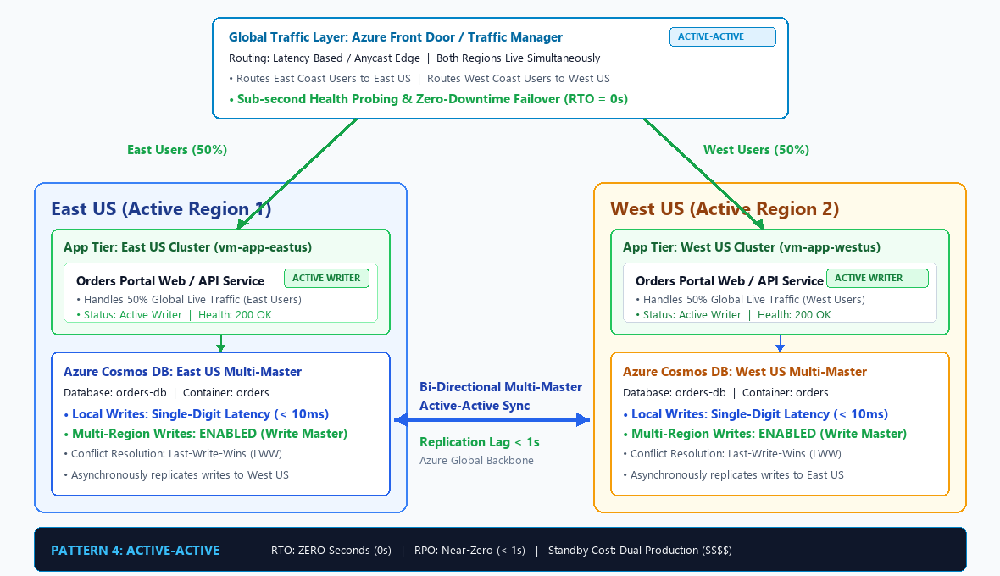
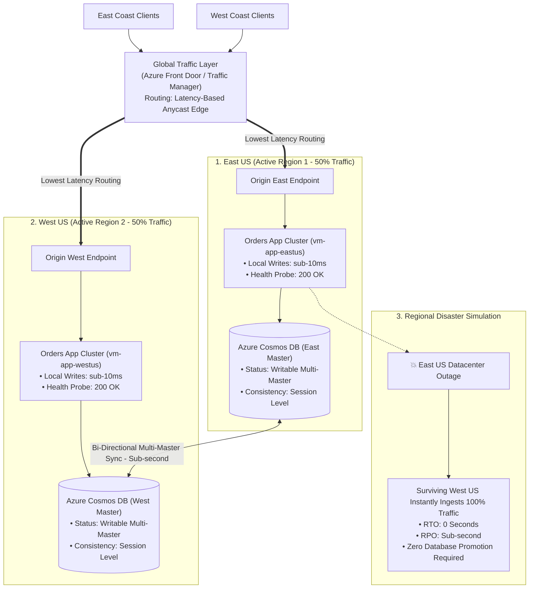

# DR Strategy 4: Active-Active Multi-Region (Always-On Multi-Master)



---

## 1. Executive Summary & The HA / DR Spectrum

In Microsoft Azure and modern cloud architecture, Disaster Recovery (DR) strategies are categorized into four core patterns based on **Cost vs. Recovery Speed**:

| Strategy | Standby Compute Cost | RTO (Recovery Time) | RPO (Data Loss) | Primary Azure Services | Best Suited For |
| :--- | :--- | :--- | :--- | :--- | :--- |
| **1. Recreate (Cold DR)** | **$0 / month** | **15 – 45 mins** | **0** *(Stateless compute)* | Terraform, Bicep, Azure Pipelines, GitHub Actions | Stateless APIs, Dev/QA, batch workers, internal tools |
| **2. Backup & Restore (Medium DR)** | **$0 / month** *(Storage only)* | **1 – 4 Hours** | **~ 1 Hour** | Azure SQL (Geo-Restore), Storage RA-GRS, Recovery Services Vault (CRR) | Line-of-business apps, non-critical databases, reporting systems |
| **3. Replicate (Warm / Hot DR)** | **High ($$$)** *(1 Active + 1 Standby)* | **< 1 – 2 Minutes** | **Near-zero (< 5s)** | Azure SQL Auto-Failover Groups, Active Geo-Replication, Azure Traffic Manager | Revenue-critical apps, single-master relational systems |
| **4. Active-Active (Multi-Master / Always-On)** *(Current)* | **Dual Production ($$$$)** | **ZERO Seconds (0s)** | **Near-zero (< 1s)** | **Azure Cosmos DB (Multi-Region Writes), Azure Front Door, AKS, Redis Enterprise** | Global e-commerce, payment processing, ride-sharing, critical telecom |

---

## 2. Core Philosophy of the "Active-Active" Pattern

In **Strategy 3 (Active-Passive Replicate)**, the secondary region runs pre-warmed compute, but it sits idle as a standby replica until an outage occurs. If `East US` fails, traffic stops while health probes detect the failure and failover mechanisms promote the secondary database.

The core philosophy of the **Active-Active** pattern is:

> *"Do not fail over. Run production in multiple cloud regions concurrently. Route users to the lowest-latency edge, synchronize multi-master writes bi-directionally, and survive catastrophic regional collapse with Zero Recovery Time (RTO = 0)."*

### Key Characteristics:
* **Zero Recovery Time (RTO = 0s)**: There is no failover script to run, no database promotion, and no disk hydration. Both regions are already 100% operational and writing data.
* **Dual-Region Multi-Master Writes**: Applications in `East US` write to their local database node in `< 10ms`. Applications in `West US` write to their local database node in `< 10ms`. Changes stream bi-directionally in the background across Microsoft's global fiber backbone.
* **Lowest Latency for Global Users**: Users in New York connect to `East US`, while users in California connect to `West US`. Network latency is minimized for all clients worldwide.
* **N+1 Headroom Capacity**: Each region typically operates at **50% utilization** during normal operations, ensuring that if one region fails, the surviving region has the elastic headroom to instantly ingest **100% of global load** without degrading.

---

## 3. High-Level Architecture & End-to-End Flow



### The 3 Pillars of the Active-Active Architecture:

1. **Global Anycast Edge (Azure Front Door)**:
   * Front Door terminates SSL and routes requests from 100+ global edge locations over Microsoft's private network directly to the lowest-latency active origin.
2. **Stateless Compute with Elastic Bursting**:
   * Compute fleets in both regions remain stateless. User authentication relies on cryptographically signed JWT tokens, eliminating inter-region session affinity requirements.
3. **Multi-Region Multi-Master Database (Azure Cosmos DB)**:
   * Microsoft's globally distributed database engine enables **`enable_multiple_write_locations = true`**.
   * Both `East US` and `West US` accept concurrent writes locally with single-digit millisecond latency, resolving conflicts automatically via built-in policies.

---

## 4. Deep Dive: Distributed Consistency & Conflict Resolution

In an Active-Active multi-master system, two users in different regions could update the same record at the exact same millisecond. Managing this requires understanding the **CAP Theorem** and **Conflict Resolution**:

### Conflict Resolution Policies in Azure Cosmos DB:
1. **Last-Writer-Wins (LWW) (Default)**:
   * Cosmos DB compares a numeric timestamp property (by default, the internal `_ts` property).
   * The write with the highest timestamp is committed; the older write is discarded.
   * *Ideal for*: E-commerce product catalogs, user profiles, status tracking.
2. **Custom Merge Procedures**:
   * A user-defined JavaScript stored procedure executes automatically when a conflict occurs.
   * *Ideal for*: Merging shopping carts (combining items from both East and West sessions rather than overwriting one).
3. **Conflict Feed**:
   * Conflicted records are committed to a read-only conflict log for asynchronous auditing and manual reconciliation.
   * *Ideal for*: Financial ledgers and banking transactions.

---

## 5. Real-World Business Scenarios

### Scenario A: Global Ride-Sharing & Mobility (Uber / Lyft)
* **Behavior**: Drivers and riders constantly update GPS coordinates and ride statuses.
* **Why Active-Active is Chosen**:
  * Drivers in Florida must write coordinates to `East US` with `< 10ms` latency; drivers in California write to `West US`.
  * If `East US` goes down, Florida drivers automatically route to `West US`. No ride matches or GPS breadcrumbs are lost.

### Scenario B: Global Streaming & Entertainment (Netflix / Spotify)
* **Behavior**: Millions of users watching streams, adding titles to watchlists, and updating playback bookmarks.
* **Why Active-Active is Chosen**:
  * High-availability SLAs guarantee 99.999% uptime.
  * Even a complete regional cloud disaster is invisible to subscribers watching video streams.

### Scenario C: High-Frequency E-Commerce Retail (Amazon / Walmart)
* **Behavior**: Black Friday flash sales with millions of checkout attempts per minute.
* **Why Active-Active is Chosen**:
  * Any failover delay would create massive checkout errors and revenue loss. Dual-active clusters absorb spiky global traffic smoothly.

---

## 6. Recovery Objectives (RTO & RPO) Deep Dive

### ⏱️ Recovery Time Objective (RTO)
* **Definition**: The total elapsed time until traffic is operational in the secondary region.
* **For Active-Active**: **ZERO Seconds (0s)**.
* **Why is RTO zero?**
  * In Strategy 1, RTO is 30 minutes (provisioning VMs).
  * In Strategy 2, RTO is 2–4 hours (hydrating disks).
  * In Strategy 3, RTO is 1–2 minutes (promoting the secondary database).
  * In **Strategy 4**, the secondary database is **already a live, running, writable master**. The compute cluster is **already warm and serving live users**. Routing shifts at the edge immediately!

### 💾 Recovery Point Objective (RPO)
* **Definition**: Maximum data loss measured in time.
* **For Active-Active**: **Near-Zero (< 1 Second)**.
* **How is this achieved?**
  * Asynchronous replication between Azure Cosmos DB write regions across Microsoft's global fiber network completes in **sub-second time (< 1,000 ms)** under normal operating conditions.

---

## 7. Real-World Gotchas & Architectural Pitfalls

1. **Dual Production Compute Costs**:
   * You are paying 24/7 for two active production clusters, two database write masters, and continuous inter-region replication egress.
2. **Capacity Planning (The 50% Rule)**:
   * If you run each region at 90% CPU capacity to save money, and one region fails, the surviving region will instantly receive 100% of global traffic, hit 180% CPU load, and crash! Always maintain at least **50% headroom** in each region.
3. **Data Consistency Trade-Offs**:
   * Active-Active requires choosing an eventual or session consistency model. Strong consistency across regions 2,500 miles apart requires synchronous roundtrips, which dramatically increases write latency.

---

## 8. Hands-On Lab: How to Test the Pattern

The Terraform code in this directory deploys:
1. **Primary Region (`East US`)**: VNet, Subnet, and active Orders App VM.
2. **Secondary Region (`West US`)**: VNet, Subnet, and active Orders App VM.
3. **Multi-Master Database Tier**: **Azure Cosmos DB Account** configured with **`enable_multiple_write_locations = true`**, an SQL Database, and an `orders` container with **Last-Writer-Wins (LWW)** conflict resolution.
4. **Global Routing Tier**: Azure Traffic Manager configured with **Performance Routing** to route clients to their lowest-latency active region.

### File Structure:
* `main.tf`: Complete declarative Terraform configuration for multi-master Cosmos DB, dual-active compute, and Traffic Manager.
* `image.png`: Architectural diagram illustrating multi-master replication and latency-based routing.

---

### Step 1: Deploy Active-Active Infrastructure
Open PowerShell in this directory:
```powershell
cd c:\Users\rag\Desktop\AzureProject\HA_DR\4.ActiveActive
terraform init
terraform apply -auto-approve
```

Key outputs returned:
* `traffic_manager_url`: Global latency-based endpoint (`http://contoso-active-xxxx.trafficmanager.net`)
* `cosmosdb_endpoint`: Global Cosmos DB Multi-Master URI
* `multi_region_writes`: `ENABLED (Multi-Master Active-Active)`
* `east_app_direct_url`: Direct URL to East US Active Writer
* `west_app_direct_url`: Direct URL to West US Active Writer

---

### Step 2: Test Dual-Region Writes in Real Time
1. Open the **East US Direct URL** in one browser tab.
   * Observe: `ACTIVE WRITER 1 (East US)`.
   * Insert an order: `Customer: New York Traders`, `Amount: $50,000.00`.
   * Order commits locally in `< 10ms`!
2. Open the **West US Direct URL** in a second browser tab.
   * Observe: `ACTIVE WRITER 2 (West US)`.
   * Refresh the page: **The order created in East US is already synchronized!**
   * Insert an order directly in West US: `Customer: California Tech`, `Amount: $85,000.00`.
   * Switch back to the East tab: **Both orders are synchronized bi-directionally!**

---

### Step 3: Simulate Regional Failure & Verify Zero-Second RTO
Simulate that `East US` suffers a complete outage:

```powershell
# Stop the East US app service
$eastIp = terraform output -raw primary_vm_public_ip
ssh azureuser@$eastIp "sudo systemctl stop orders-app"
```

1. Open the global **`traffic_manager_url`**.
2. Within seconds, all traffic routes to `West US`.
3. **No database failover command was required**. `West US` was already accepting writes and serving orders!
4. **Actual RTO: ZERO Seconds!**

---

### Step 4: Cleanup Lab Resources
When testing is complete, destroy all cloud resources:

```powershell
terraform destroy -auto-approve
```

---

## 9. Master Comparison: The 4 Cloud DR Archetypes

```
[ Tier 1: Recreate        ] --> $0 Standby    | RTO: 30m | RPO: 0     | Stateless / IaC
[ Tier 2: Backup & Restore] --> Storage Only  | RTO: 2-4h| RPO: 1h    | Relational / GRS Geo-Restore
[ Tier 3: Replicate       ] --> 1 Active+1Stby| RTO: < 1m| RPO: < 5s  | Active-Passive / Failover Group
[ Tier 4: Active-Active   ] --> Dual Active   | RTO: 0s  | RPO: < 1s  | Always-On / Multi-Master (Cosmos DB)
```

