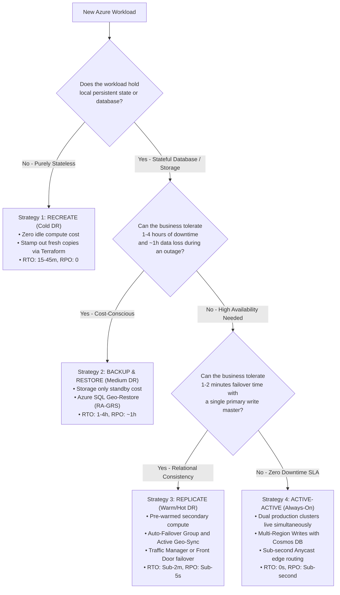

# Azure High Availability (HA) & Disaster Recovery (DR) Master Blueprint

A hands-on, production-grade guide and Infrastructure-as-Code (Terraform) blueprint demonstrating the four fundamental cloud Disaster Recovery & High Availability patterns in Microsoft Azure.

---
```
HA_DR/
├── README.md                  <-- Master Blueprint & Decision Framework Flowchart
│
├── 1.Recreate/                <-- Cold DR ($0 Standby | RTO: 30m | RPO: 0 Stateless)
│   ├── README.md
│   ├── image.png
│   └── main.tf
│
├── 2.BackupRestore/           <-- Medium DR (Storage only | RTO: 1-4h | RPO: ~1h Stateful SQL)
│   ├── README.md
│   ├── image.png
│   └── main.tf
│
├── 3.Replicate_ASR/           <-- Warm/Hot DR (Active-Passive | RTO: < 1m | RPO: < 5s)
│   ├── README.md
│   ├── image.png
│   └── main.tf
│
└── 4.ActiveActive/            <-- Always-On (Multi-Master | RTO: 0s | RPO: < 1s)
    ├── README.md
    ├── image.png
    └── main.tf
```

## 🧭 The HA / DR Spectrum: Cost vs. Recovery Speed

In modern cloud architecture, Disaster Recovery is a trade-off between **Recovery Speed (RTO/RPO)** and **Standby Infrastructure Cost**. 

| # | DR Pattern | Standby Compute Cost | Target RTO (Recovery Time) | Target RPO (Data Loss) | Primary Azure Services | Best Suited For |
| :-: | :--- | :--- | :--- | :--- | :--- | :--- |
| **1** | **[Recreate (Cold DR)](1.Recreate/README.md)** | **$0 / month** | **15 – 45 mins** | **0** *(Stateless compute)* | Terraform, GitHub Actions, Azure Pipelines | Stateless APIs, Dev/QA, batch workers, worker nodes |
| **2** | **[Backup & Restore (Medium DR)](2.BackupRestore/README.md)** | **$0 / month** *(Storage only)* | **1 – 4 Hours** | **~ 1 Hour** | Azure SQL Geo-Restore, Storage RA-GRS, Recovery Services Vault (CRR) | Line-of-business apps, ERP/CRM, order tracking, regulatory archives |
| **3** | **[Replicate (Warm / Hot DR)](3.Replicate_ASR/README.md)** | **High ($$$)** *(1 Active + 1 Standby)* | **< 1 – 2 Minutes** | **Near-zero (< 5s)** | Azure SQL Auto-Failover Groups, Active Geo-Replication, Traffic Manager / Front Door | Mission-critical financial systems, payment gateways, e-commerce checkout |
| **4** | **[Active-Active (Multi-Master / Always-On)](4.ActiveActive/README.md)** | **Dual Production ($$$$)** | **ZERO Seconds (0s)** | **Near-zero (< 1s)** | **Azure Cosmos DB (Multi-Region Writes), Azure Front Door, AKS, Redis Enterprise** | Global e-commerce, real-time gaming, ride-sharing, critical telecom |

---

## 🗺️ Architectural Decision Framework

Use this flowchart to determine which DR pattern fits your business workload:



---

## 📂 Repository Structure & Hands-On Modules

Each directory contains a complete, self-contained architecture documentation (`README.md`), visual architecture diagram (`image.png`), and production-ready Terraform code (`main.tf`):

### 1. [1. Recreate (Cold DR)](1.Recreate/README.md)
* **Concept**: Treat infrastructure as disposable "cattle". Keep secondary region compute at \$0/month and provision workloads on demand during an incident using parameterized Terraform pipelines.
* **Lab Setup**: Linux Web VM with custom landing page deployed to `East US`, with instant failover measurement to `West US`.
* **Key Command**: `terraform apply -var="target_region=westus"`

### 2. [2. Backup & Restore (Stateful DR)](2.BackupRestore/README.md)
* **Concept**: Decouple state from compute. Store automated database backups in Read-Access Geo-Redundant Storage (RA-GRS) and restore on demand without paying for idle secondary database compute.
* **Lab Setup**: Two-tier web application connected to an Azure SQL Database with live order transaction insertion, verified against secondary geo-replicated backups.
* **Key Command**: `az sql db restore --server <SECONDARY_SERVER> --dest-name sqldb-orders-restored`

### 3. [3. Replicate (Warm / Hot DR)](3.Replicate_ASR/README.md)
* **Concept**: Zero-downtime business continuity. Pre-warm secondary compute, stream transaction logs continuously across the Azure private backbone (lag < 2s), and route global traffic via Azure Traffic Manager.
* **Lab Setup**: Dual-region web VMs, Azure SQL Auto-Failover Group with global listener, and Azure Traffic Manager with 10-second automated `/health` probes.
* **Key Command**: Stop primary service $\rightarrow$ observe automated failover in under 60 seconds with zero data loss.

### 4. [4. Active-Active (Multi-Region Multi-Master)](4.ActiveActive/README.md)
* **Concept**: Eliminate failover entirely. Run active production clusters in both regions concurrently. Synchronize multi-master writes bi-directionally using Azure Cosmos DB Multi-Region Writes and route users to the nearest low-latency edge.
* **Lab Setup**: Dual-active web applications in `East US` and `West US`, Azure Cosmos DB with Multi-Region Writes enabled (`enable_multiple_write_locations = true`), and Latency/Performance-based Traffic Manager routing.
* **Key Command**: Write orders in East US or West US concurrently $\rightarrow$ observe bi-directional synchronization with **RTO = 0 seconds**.

---

## 🛠️ Prerequisites & Quick Start

* [Azure CLI (`az`)](https://docs.microsoft.com/cli/azure/install-azure-cli) installed and logged in (`az login`).
* [Terraform (>= 1.0.0)](https://www.terraform.io/downloads) installed.
* PowerShell 7+ or standard PowerShell.
